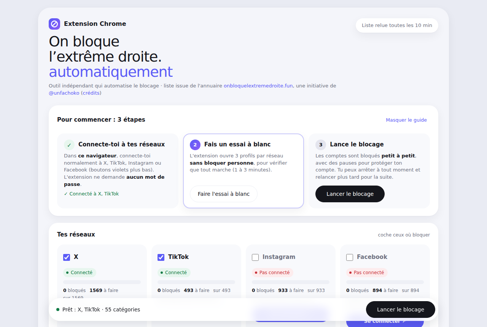
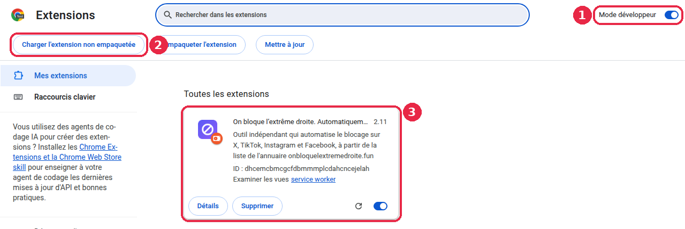
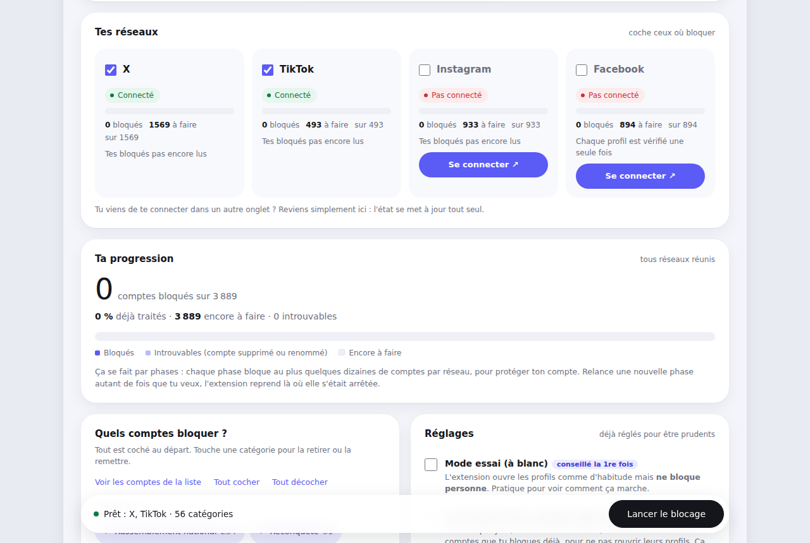
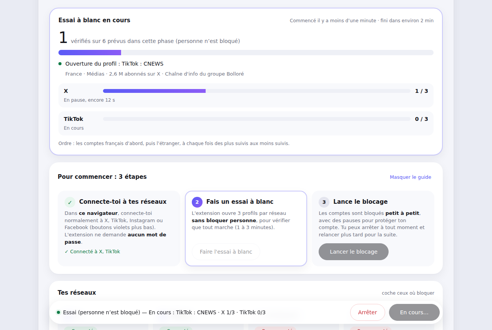

# Bloquer l’extrême droite sur les réseaux sociaux, automatiquement

**Une extension gratuite pour Google Chrome et les navigateurs Chromium (sur ordinateur)** qui bloque pour toi, sur **X, TikTok, Instagram et Facebook**,
les comptes d’extrême droite listés par l’annuaire public **[onbloquelextremedroite.fun](https://onbloquelextremedroite.fun)**.

Tu choisis les réseaux, tu cliques sur « Lancer » : l’extension ouvre les profils un par un, lentement, et clique sur « Bloquer » à ta place.
Plus de fil d’actualité pollué, sans y passer des heures.

> ### 💻 Uniquement sur ordinateur, avec Google Chrome (ou un navigateur Chromium)
> L’extension s’installe dans **Google Chrome sur un ordinateur** (Windows, Mac ou Linux).
> Elle marche aussi dans les autres **navigateurs basés sur Chromium** : Brave, Microsoft Edge, Opera, Vivaldi, Arc…
> Elle ne marche **pas sur téléphone ni tablette**, et pas dans Safari ni Firefox.
> Pas de Chrome ? Il est gratuit : [google.com/chrome](https://www.google.com/chrome/).
> Bonne nouvelle : les comptes bloqués depuis l’ordinateur sont **aussi bloqués dans les applis de ton téléphone**.

<p align="center"><b>👉 <a href="https://github.com/bender-md/bloquer-extreme-droite/releases/latest/download/bloquer-extreme-droite.zip">Télécharger l’extension</a></b> (fichier .zip, gratuit)<br>
puis suis le <a href="#installation-pas-à-pas-5-minutes">tutoriel d’installation</a> ci-dessous.</p>



---

## En bref

| | |
|---|---|
| **Où ça marche ?** | **Uniquement sur ordinateur** (Windows, Mac ou Linux), dans **Google Chrome** ou un autre navigateur **Chromium** (Brave, Edge, Opera, Vivaldi, Arc…). Pas sur téléphone ni tablette, ni Safari, ni Firefox. Les blocages faits sur l’ordinateur s’appliquent aussi dans les applis du téléphone. |
| **C’est payant ?** | Non. Gratuit, sans publicité, sans compte à créer. |
| **D’où vient la liste ?** | De l’annuaire [onbloquelextremedroite.fun](https://onbloquelextremedroite.fun), tenu par un collectif bénévole qui vérifie chaque compte. La liste se met à jour toute seule. |
| **C’est sûr ?** | Oui, voir juste en dessous. |

---

## Est-ce que c’est sûr ?

**Pour ton ordinateur et tes données : oui.**

- **Aucun mot de passe demandé.** Tu te connectes toi-même à tes réseaux, comme d’habitude. L’extension utilise simplement ta session ouverte, comme si tu cliquais toi-même.
- **Rien n’est envoyé nulle part.** L’extension ne parle qu’à l’annuaire (pour lire la liste) et aux réseaux eux-mêmes (pour bloquer). Pas de serveur à nous, pas de statistiques, pas de publicité.
- **Elle n’a accès qu’à 5 sites** : x.com, tiktok.com, instagram.com, facebook.com et onbloquelextremedroite.fun. Elle ne voit pas le reste de ta navigation.
  Elle lit aussi le classement des comptes publié sur cette page GitHub (un simple fichier, sans rien envoyer).
- **Ta progression reste dans ton navigateur.**
- **Le code est public** : tout est lisible sur cette page (fichiers `.js` et `.html`), n’importe qui peut le vérifier.
- **Elle ne fait que bloquer** : elle n’écrit à personne, ne signale personne, ne publie rien.

**Pourquoi Chrome parle de « mode développeur » ?** Parce que l’extension n’est pas sur le Chrome Web Store
(les réseaux interdisent l’automatisation, elle y serait refusée). Chrome demande donc d’activer ce mode pour l’installer à la main.
C’est normal et sans danger : ça permet juste d’installer une extension depuis un dossier.

**Pour ton compte sur les réseaux : il y a un petit risque.** X, TikTok, Instagram et Facebook interdisent les outils automatiques.
S’ils trouvent qu’on va trop vite, ils peuvent demander une vérification (« captcha ») ou limiter ton compte quelques heures.
C’est pour ça que l’extension va **volontairement lentement** et s’arrête toute seule au moindre signal.
Garde les réglages par défaut et tout se passera bien.

Détails : [docs/CONFIDENTIALITE.md](docs/CONFIDENTIALITE.md).

---

## Installation pas à pas (5 minutes)

Tu n’as besoin de rien connaître à GitHub ni aux extensions. Suis juste les étapes.

Tout se fait **sur ton ordinateur, dans Google Chrome**. Le tutoriel montre Chrome ; dans un autre navigateur Chromium, c’est pareil
(seule l’adresse de l’étape 3 change, voir plus bas).

### Étape 1 : télécharger

Clique ici : **[⬇️ Télécharger l’extension](https://github.com/bender-md/bloquer-extreme-droite/releases/latest/download/bloquer-extreme-droite.zip)**.
Un fichier `.zip` arrive dans ton dossier **Téléchargements**.

**Il y a deux façons de télécharger sur GitHub. Les deux marchent**, seul le nom du dossier change :

| Ce sur quoi tu cliques | Ce que tu obtiens | Le dossier à choisir à l’étape 4 |
|---|---|---|
| **⬇️ Télécharger l’extension** (le lien ci-dessus, conseillé) | `bloquer-extreme-droite.zip` : seulement l’extension | `bloquer-extreme-droite` |
| Le bouton vert **« Code » → « Download ZIP »** (en haut de la page) | `bloquer-extreme-droite-main.zip` : l’extension + les explications du projet | `bloquer-extreme-droite-main` |

Dans les deux cas, le dossier à choisir est **celui qui contient le fichier « C’EST LE BON DOSSIER - choisis celui-ci dans Chrome »** (voir l’étape 2).

### Étape 2 : décompresser et trouver le bon dossier

1. **Décompresse le fichier .zip** :
   - **Mac** : double-clique dessus.
   - **Windows** : clic droit dessus → **« Extraire tout… »** → **« Extraire »**.
2. **Vérifie que c’est le bon dossier.** Ouvre le dossier qui vient d’apparaître :
   - ✅ Tu vois un fichier qui s’appelle **« C’EST LE BON DOSSIER - choisis celui-ci dans Chrome »** (avec `manifest.json`,
     `panneau.html`…) ? **C’est le bon.**
   - ↪️ Tu ne vois qu’**un seul dossier** à l’intérieur ? (ça arrive avec le bouton vert « Code », surtout sur Windows)
     **Entre dedans** : c’est lui qui contient le fichier « C’EST LE BON DOSSIER ».

   Si Chrome affiche « Fichier manifeste absent ou illisible », c’est que tu as choisi le dossier au-dessus du bon.
3. **Range ce dossier** dans un endroit où il restera, par exemple dans **Documents**.
   ⚠️ **Ne le supprime pas** après l’installation : Chrome en a besoin. Si tu le supprimes, l’extension disparaît.

### Étape 3 : ouvrir la page des extensions de Chrome

Copie ceci dans la barre d’adresse de Chrome, puis appuie sur Entrée :

```
chrome://extensions
```

Autres navigateurs Chromium : Brave `brave://extensions` · Edge `edge://extensions` (le « Mode développeur » y est dans la colonne de gauche) ·
Opera `opera://extensions` · Vivaldi `vivaldi://extensions`.

### Étape 4 : installer



1. **Active le « Mode développeur »** : l’interrupteur en haut à droite.
2. **Clique sur « Charger l’extension non empaquetée »** (en anglais : *Load unpacked*), qui vient d’apparaître en haut à gauche.
   Choisis **le bon dossier de l’étape 2** (celui qui contient le fichier « C’EST LE BON DOSSIER »), puis clique sur **« Sélectionner »**.
3. **L’extension apparaît** dans la liste : « On bloque l’extrême droite. Automatiquement ». C’est installé !

### Étape 5 : épingler l’icône

Clique sur la **pièce de puzzle 🧩** en haut à droite de Chrome, puis sur la **punaise 📌** à côté de l’extension.
Son icône (un cercle barré violet) reste maintenant visible. **Un clic dessus ouvre le panneau.**

---

## Utilisation en 3 étapes

Le panneau te guide : les 3 étapes y sont affichées en haut.

### 1. Connecte-toi à tes réseaux

Dans **ce même Chrome**, connecte-toi normalement à x.com, tiktok.com, instagram.com et/ou facebook.com.
Dans le panneau, chaque réseau affiche **« Connecté »** en vert, ou un bouton violet **« Se connecter »**.



### 2. Fais un essai à blanc

Clique sur **« Faire l’essai à blanc »**. L’extension ouvre 3 profils par réseau **sans bloquer personne**, pour vérifier que tout marche.
Une carte en haut montre ce qui se passe en direct : le compte en cours (avec son pays, ses abonnés et la raison de sa présence dans l’annuaire),
l’avancement de chaque réseau et le temps restant.



### 3. Lance le blocage

Clique sur **« Lancer le blocage »**. Une fenêtre s’ouvre en arrière-plan : **laisse-la ouverte** (tu peux la réduire)
et continue à utiliser ton ordinateur normalement.

- Le blocage se fait **par phases** : à chaque lancement, au plus 40 comptes sur X, 25 sur TikTok, 15 sur Instagram et Facebook.
  **Relance une nouvelle phase autant de fois que tu veux** : l’extension reprend là où elle s’était arrêtée.
  Plusieurs phases espacées (par exemple une par heure) sont plus sûres qu’une seule énorme.
- Les comptes **français passent d’abord**, puis ceux de l’étranger, à chaque fois **des plus suivis aux moins suivis**.
- Tu peux choisir les catégories (Rassemblement national, médias, influenceurs, pays étrangers…) dans « Quels comptes bloquer ? ».
- Le bouton **« Arrêter »** en bas arrête tout de suite.

---

## Ce qu’elle fait aussi

- **La liste se met à jour toute seule**, relue sur l’annuaire à chaque ouverture puis toutes les 10 minutes.
  Les nouveaux comptes de l’annuaire sont **rangés automatiquement dans la bonne catégorie** (vérification toutes les 10 minutes).
  Un badge « +N » sur l’icône signale les nouveaux comptes.
- **Elle ne rouvre pas les comptes déjà bloqués** : elle lit ta liste de bloqués (X et TikTok) et retient ce qu’elle a fait.
- **Comptes retirés de l’annuaire** : si un compte qu’elle a bloqué pour toi est retiré de la liste, il apparaît dans « Plus dans la liste »,
  avec un bouton **« Débloquer »** (automatique sur X, TikTok et Instagram) ou **« Garder bloqué »**.
- **Partager** : des boutons X, Facebook, WhatsApp, Telegram et Threads pour faire connaître l’extension et l’annuaire.
  Rien n’est publié sans que tu valides.

---

## Mettre à jour l’extension

La **liste** se met à jour toute seule. Pour une **nouvelle version de l’extension** :

1. Télécharge à nouveau **[bloquer-extreme-droite.zip](https://github.com/bender-md/bloquer-extreme-droite/releases/latest/download/bloquer-extreme-droite.zip)** et décompresse-le.
2. Remplace ton ancien dossier `bloquer-extreme-droite` par le nouveau (au même endroit).
3. Dans `chrome://extensions`, clique sur la flèche **↻** de l’extension.

Ta progression est gardée.

## Désinstaller

Dans `chrome://extensions`, clique sur **« Supprimer »** sous l’extension, puis supprime le dossier.
Les comptes déjà bloqués **restent bloqués**.

---

## Questions fréquentes

**Un captcha (« vérification ») apparaît.**
L’extension met ce réseau de côté et laisse sa fenêtre ouverte. Fais la vérification toi-même, attends une trentaine de minutes, puis relance.

**Mon compte a été limité.**
Suis les instructions du réseau (souvent un code par e-mail ou SMS), puis attends au moins 24 h avant de relancer, avec un petit maximum
(5 à 10, dans « Réglages »). L’extension ne connaît pas ton mot de passe et ne peut rien faire à ta place.

**Chrome affiche « Échec du chargement de l’extension · Fichier manifeste absent ou illisible ».**
Tu as choisi le mauvais dossier : celui au-dessus du bon. Ouvre-le : à l’intérieur, il y a un autre dossier. Recommence
« Charger l’extension non empaquetée » en choisissant ce dossier intérieur (celui qui contient le fichier « C’EST LE BON DOSSIER »).

**Le panneau dit « Pas connecté » alors que je le suis.**
Tu dois être connecté **dans ce même Chrome** (et pas en navigation privée). Clique sur « Se connecter », connecte-toi,
puis reviens sur l’onglet du panneau : il se met à jour tout seul.

**« La liste des comptes n’a pas pu être chargée ».**
Ouvre [onbloquelextremedroite.fun](https://onbloquelextremedroite.fun) dans un onglet, attends que la page s’affiche, puis touche « Réessayer ».

**Des comptes sont « Introuvables ».**
Ils ont été supprimés, suspendus ou renommés. Ils sont comptés à part et ne sont pas réessayés.

**Un compte de la liste me semble faux.**
La liste appartient à l’annuaire : signale-le sur [onbloquelextremedroite.fun](https://onbloquelextremedroite.fun).

**Ça marche sur mon téléphone, ou dans Safari / Firefox ?**
Non : uniquement sur ordinateur, avec Google Chrome ou un autre navigateur Chromium (Brave, Edge, Opera, Vivaldi, Arc…). Les téléphones n’acceptent pas ce type d’extension.
Mais tout ce que tu bloques depuis l’ordinateur reste bloqué dans les applis de ton téléphone.

**Pourquoi pas sur le Chrome Web Store ?**
Parce que l’extension automatise des clics sur des réseaux qui l’interdisent : elle y serait refusée. L’installation à la main permet aussi
à chacun de lire le code avant de l’utiliser.

---

## Qui fait quoi

> **Tout le travail de recherche et de vérification des comptes est celui de l’annuaire, pas le nôtre.**

- L’annuaire **[On bloque l’extrême droite](https://onbloquelextremedroite.fun)** est une initiative de
  **[@unfachoko](https://x.com/unfachoko)**, tenue par un collectif bénévole. **[Le soutenir sur Tipeee](https://fr.tipeee.com/onbloquelextremedroite)**.
- **Cette extension est un outil indépendant** : elle n’est pas faite par l’équipe de l’annuaire, qui n’en est pas responsable.
  Elle lit la liste publique de l’annuaire et automatise les clics de blocage.
- Bloquer n’est pas harceler : comme l’annuaire, nous rejetons toute violence, menace ou harcèlement.

**Crédits** : données reprises par l’annuaire (relevés d’abonnés de Le Podium 2027, CC BY 4.0 ; Saper Vedere ; Assemblée nationale).
Liens TikTok / Instagram / Facebook complémentaires : données ouvertes de l’Assemblée nationale, Wikidata, profils publics vérifiés.
Le parcours de blocage sur X s’inspire de [Blockfacho](https://blockfacho.pages.dev). Logos de partage : [Simple Icons](https://simpleicons.org) (CC0).

## Pour aller plus loin

- [docs/UTILISATION.md](docs/UTILISATION.md) : mode d’emploi détaillé du panneau
- [docs/CONFIDENTIALITE.md](docs/CONFIDENTIALITE.md) : ce que l’extension voit, garde et envoie
- [docs/FONCTIONNEMENT.md](docs/FONCTIONNEMENT.md) : fonctionnement technique, pour qui veut lire ou améliorer le code
- [docs/CHANGELOG.md](docs/CHANGELOG.md) : historique des versions

## Licence

[MIT](LICENSE) : tu peux utiliser, copier, modifier et partager ce code librement, sans garantie.
La licence couvre le code de l’extension, pas la liste de l’annuaire, qui reste celle de ses auteurs.
